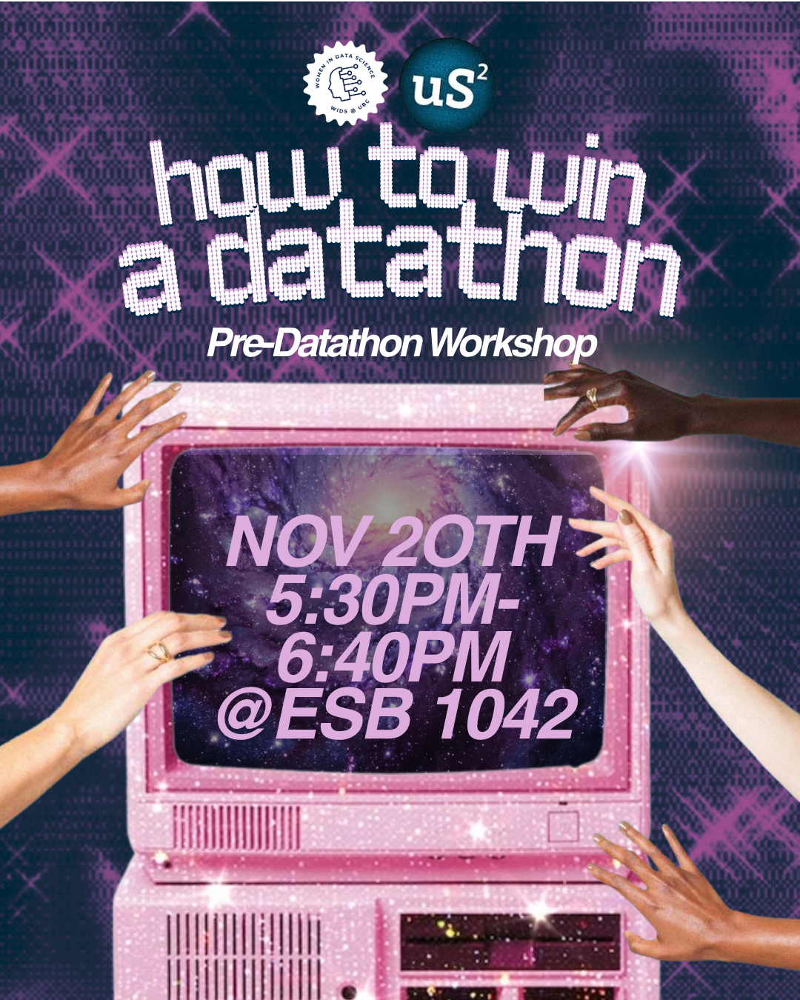

{width=50%}

## Overview

I designed and led How to Win a Datathon 101, a hands-on workshop for Dataverse 2026. The goal was to give beginners a repeatable workflow they could take straight into a datathon: meet your data, explore it with purpose, model only the insights that you can explain, and tell a story the judges will remember.

Participants worked through a Jupyter notebook alongside the slides, with TRY IT YOURSELF! exercises at three levels (Easy, Medium, Hard) and hidden solutions to check their work.

## The case

> **The (hypothetical) client:** the City of Vancouver wants to run a campaign that gets residents and visitors exploring more neighbourhoods, driving foot traffic to local businesses. They want to know which areas to promote, and when.

**The data:** the City of Vancouver's [Public trees](https://opendata.vancouver.ca/explore/assets/public-trees/export/) dataset, with ~184,000 trees (Open Government Licence – Vancouver).

## What we covered

**Part 1: Meet & clean your data.** Six checks to run on any new dataset: structure, relevant variables, missing values, data types, inconsistencies, and impossible values & outliers. One highlight: about 3,900 trees had no neighbourhood, and most of them turned out to be in Stanley Park. If we had preemptively deleted them, we would have lost data for one of Vancouver's most famous parks!

**Part 2: Exploratory data analysis.** Four pointers for EDA (i.e., start with a question, one variable at a time, compare & connect, follow the surprises) and how the kind of question you ask points you to the right chart.

**Part 3: Data modelling.** A full classification walkthrough: *can we predict whether a tree is a cherry from its size and neighbourhood?* We compared a baseline against logistic regression and a decision tree, and saw why accuracy can be misleading when the thing you're looking for is rare. A dummy model that never says "cherry" is still ~90% accurate! Weighting the rare class brought recall from ~24% to ~62%.

**Top secret: a blueprint for a winning project.** Strong technical work is the foundation, but winning projects also have impact and tell a story.

## Key takeaways

- **Look before you clean.** Understand your data's condition and limits before changing anything.
- **Every fix is a decision.** Be able to explain your choices, and write them down as you go.
- **Don't delete blindly.** Missing or odd data might be telling you something more than what's on the surface.
- **Start simple.** Begin with a baseline, pick the score that matters to your client, and only add complexity if it clearly helps.

## Materials

::: {.grid}
::: {.g-col-12 .g-col-md-6}
[Download the slides (PDF)](slides.pdf){.btn .btn-outline-primary role="button"}
:::
::: {.g-col-12 .g-col-md-6}
[Download the notebook (.ipynb)](dataverse_2026_PARTICIPANT.ipynb){.btn .btn-outline-primary role="button" download="dataverse_2026_PARTICIPANT.ipynb"}
:::
:::

To run the notebook, download `public-trees.csv` from the [City of Vancouver Open Data Portal](https://opendata.vancouver.ca/explore/assets/public-trees/export/) and follow the setup steps at the top.

### Slides

<iframe src="slides.pdf" width="100%" height="500" style="border: none;" title="How to Win a Datathon 101 slides"></iframe>

**Tools:** Python, pandas, matplotlib, scikit-learn, Jupyter / Google Colab